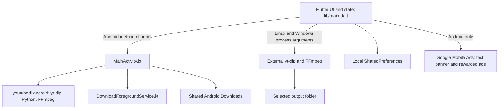

# Architecture

## Runtime boundaries

`DownAnyMediaApp` owns theme selection. `DownloaderPage` and its state in `lib/main.dart` own intake, analysis, downloads, queue persistence, history, settings, ads, and desktop process management. The UI uses Material 3. `linux/` and `windows/` contain Flutter runners.

The Android channel is `down_any_media/android_downloader`. Kotlin implements analysis, download/cancel, engine status, FFmpeg execution diagnostics, shared-link intake, opening files, and progress callbacks. Downloads use `io.github.junkfood02.youtubedl-android` version 0.18.1. A foreground service supplies progress and cancellation notifications.

## Download flow

URL edits schedule analysis after a 650 ms debounce. Analysis invokes yt-dlp with JSON/flat-playlist options; it is a network operation rather than a purely local URL check. Optional smart cleaning removes selected tracking parameters; failures can retry the original URL.

Audio uses `bestaudio/best`, MP3 extraction, a chosen quality value, and optional metadata/artwork embedding. Video uses quality-based selectors and progressively simpler fallback attempts. FFmpeg availability, website changes, and available codecs affect the final result. Progress output supplies stage, percentage, speed, and ETA where available.

Desktop resolves bundled paths before searching `PATH`, runs executables with argument lists and `runInShell: false`, and writes into the selected folder. Android executes bundled tools, attempts a stable yt-dlp update before downloads, writes to a private work directory, and publishes completed media through MediaStore. Temporary files are filtered before publishing. Engine updates can change extraction behavior without rebuilding Flutter code.

## Queue and local state

Playlist items run one at a time. Pause takes effect between items; cancellation stops the active process. Failed entries can be retried. Saved queue state restores on launch for review and resumption, rather than silently restarting downloads. This is queue persistence, not a guarantee of byte-level resume after a process is killed.

SharedPreferences stores `download_folder`, `download_history`, `download_queue_state`, `playlist_filename_style`, `embed_metadata`, `embed_thumbnail`, `audio_quality`, `video_quality`, `theme_mode`, `smart_url_cleaning`, and `ads_hidden_until`. These preferences are not an encrypted vault. History removal removes the record, not the media file. Diagnostics can include URLs and device paths.

## Standalone modules and current limitations

The following modules are included as reusable infrastructure with tests or supporting code, but are not imported by `lib/main.dart` and are not active application features:

- URL classification (`url_classifier.dart`), error mapping, retry policy, preflight decisions, and download archive helpers.
- Playlist selection model and `playlist_selection_panel.dart`; the running UI currently uses its own playlist and queue implementation.
- `RemoteConfigService`, remote config models/crypto, `AdController`, and `AppLog`. The running UI has separate local log and test-ad code.

The remote service can load cached plaintext JSON, fetch and decrypt a blob, reject older config versions, and fall back to cached/compiled defaults. It has no default URL. If a caller explicitly constructs it with a URL (or sets `REMOTE_CONFIG_URL` at build time), it can contact that endpoint. It refreshes on initialization and on explicit refresh/staleness checks; it does not install a recurring timer. It ships an all-zero placeholder AES key. The developer tooling emits XOR key parts for custom deployments; they are recoverable from the client and do not provide a trusted signature. See the [remote configuration guide](tools/remote_config/README.md).

`AdController` contains configurable interstitial cadence and test-ID overrides, but the running UI initializes only its own banner and rewarded test ads. Remote platform switches, notices, and ad settings currently have no effect on that UI. Likewise, unit-tested URL classification or preflight rules are not guarantees that the running download path enforces them.

## Source layout

| Path | Purpose |
| --- | --- |
| `lib/main.dart` | Running app, state, UI, desktop execution |
| `lib/models/`, `lib/services/`, `lib/widgets/` | Standalone modules described above |
| `lib/app_strings.dart` | Supporting module strings |
| `android/app/src/main/kotlin/` | Android engine bridge and foreground service |
| `linux/`, `windows/` | Platform runners |
| `test/` | Widget smoke test and standalone module tests |
| `tools/remote_config/` | Optional developer-side config tooling |

## Verification scope

`flutter analyze` checks Dart source and `flutter test` checks the existing suite plus endpoint-disable behavior. These checks do not download real media, test ads on devices, compile Windows, validate every FFmpeg ABI, or establish website compatibility. Native/device testing remains necessary for releases.
